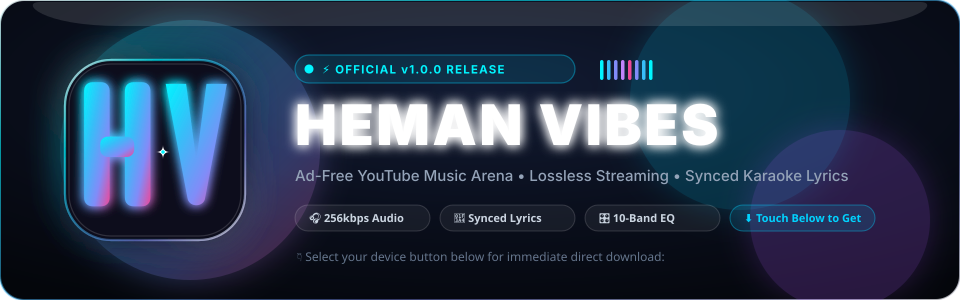
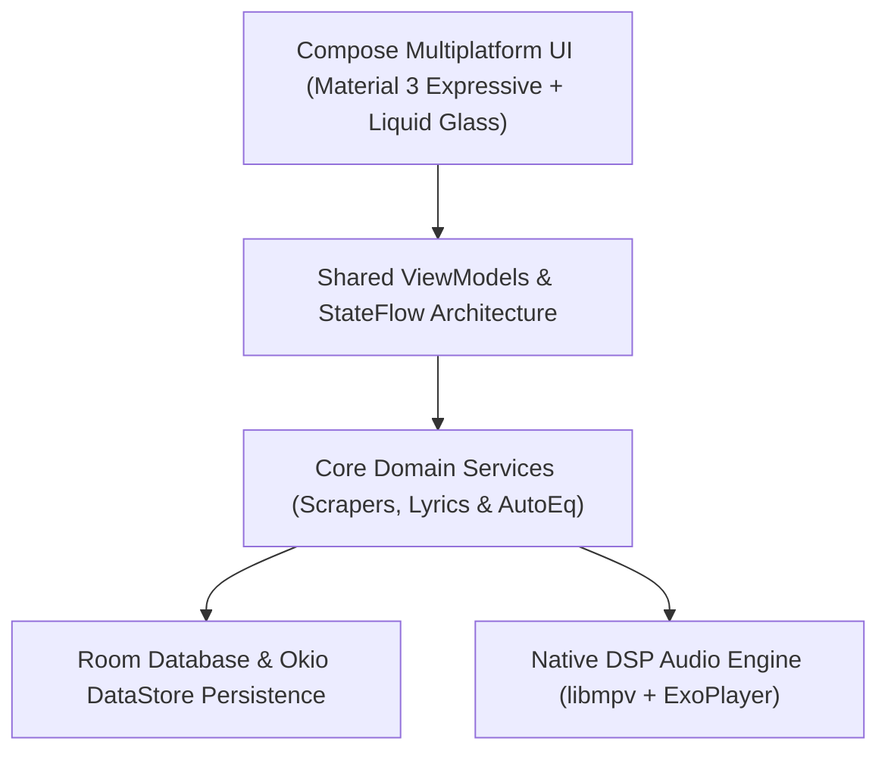

 
 

<!-- TOUCH & DOWNLOAD BUTTONS (DIRECT ONE-CLICK DOWNLOADS) -->

  
  &nbsp;
  
  &nbsp;
  
  &nbsp;
  
  &nbsp;
  

 

  <b>A modern, ad-free music streaming arena built with Compose Multiplatform &amp; Kotlin.</b> 
  <i>Stream YouTube Music at up to 256kbps with synced karaoke lyrics, 10-band DSP equalizer, Spotify canvas, and multi-device sync.</i>

---

## 📥 Direct Downloads for All Devices

Touch or click any direct download button above or choose from the table below:

| Platform | Architecture / Format | Direct Download |
| :--- | :--- | :--- |
| **🪟 Windows** | Windows 10 / 11 (x64) | [**Download Windows Installer (.zip)**](https://github.com/hemansubedi10/musicapp/releases/download/v1.0.0/HeManVibes-Windows-installer.zip) |
| **🍎 macOS (Apple Silicon)** | M1 / M2 / M3 / M4 (arm64) | [**Download macOS Apple Silicon (.dmg)**](https://github.com/hemansubedi10/musicapp/releases/download/v1.0.0/HeManVibes-mac-aarch64.dmg) |
| **🍏 macOS (Intel)** | Intel Core (x86_64) | [**Download macOS Intel (.dmg)**](https://github.com/hemansubedi10/musicapp/releases/download/v1.0.0/HeManVibes-mac-amd64.dmg) |
| **🤖 Android** | Android 8.0+ (Universal APK) | [**Download Android Universal (.apk)**](https://github.com/hemansubedi10/musicapp/releases/download/v1.0.0/HeManVibes-Android-universal.apk) |
| **🐧 Linux** | All Distributions (AppImage) | [**Download Linux Release**](https://github.com/hemansubedi10/musicapp/releases/latest) |

> [!TIP]
> **Windows Installation**: Extract `HeManVibes-Windows-installer.zip` and run `HeManVibes.exe` or click the generated desktop shortcut for immediate playback with zero setup.

---

## ✨ Key Highlights & Features

<table>
  <tr>
    <td width="50%" valign="top">
      <h3>🎵 100% Ad-Free Streaming</h3>
      <ul>
        <li>Background playback with screen locked.</li>
        <li>High-fidelity Opus &amp; AAC audio up to 256kbps.</li>
        <li>Continuous DJ-style crossfade transitions.</li>
        <li>Zero trackers or telemetry in the FOSS edition.</li>
      </ul>
    </td>
    <td width="50%" valign="top">
      <h3>🎤 Word-by-Word Synced Lyrics</h3>
      <ul>
        <li>Apple Music &amp; Spotify aesthetic lyric designs.</li>
        <li>Real-time syllable and line highlighting.</li>
        <li>Romanization support for 12+ Asian languages.</li>
        <li>Community-powered lyrics database integrations.</li>
      </ul>
    </td>
  </tr>
  <tr>
    <td width="50%" valign="top">
      <h3>🎛️ 10-Band Studio Equalizer</h3>
      <ul>
        <li>Integrated AutoEq headphone profiles (5,000+ models).</li>
        <li>Custom delay, reverb, and spatial bass boost.</li>
        <li>Native device routing without hijacking other apps.</li>
        <li>Preset curves for Rock, Jazz, Classical &amp; Vocal.</li>
      </ul>
    </td>
    <td width="50%" valign="top">
      <h3>📱 Multi-Device Ecosystem</h3>
      <ul>
        <li>QR code scan to sync playlists between Phone and PC.</li>
        <li><b>Listen Together</b> live rooms to sync audio with friends.</li>
        <li>Offline caching and smart storage management.</li>
        <li>Spotify Canvas video loop integration.</li>
      </ul>
    </td>
  </tr>
</table>

---

## 🖥️ Desktop Interface

  
  
<i>Desktop Studio Layout featuring Sidebar Navigation, Library Management, and Glass Mini-Player</i>

---

## 📱 Mobile Experience

  
  
  
  

  
  
  
  

---

## 🛠️ Architecture & Technology Stack

HeMan Vibes leverages **Kotlin Multiplatform (KMP)** and **Compose Multiplatform** to provide unified native performance across desktop and mobile operating systems:

- **UI Framework**: JetBrains Compose Multiplatform with Material 3 Expressive design tokens.
- **Audio DSP**: Embedded `libmpv` native slices across Windows, macOS, and Linux; ExoPlayer on Android.
- **Networking**: Ktor 3.6 &amp; OkHttp with asynchronous coroutine streaming.
- **Dependency Injection**: Koin 4.2.
- **Database**: Room multiplatform with SQLite bundled drivers.

---

## ⚖️ Legal Disclaimer

- **100% Free & Open-Source**: HeMan Vibes is strictly non-commercial and published under the GNU General Public License v3.0.
- **No File Hosting**: HeMan Vibes does not host or distribute media files. It functions as a specialized client rendering public YouTube and YouTube Music endpoints.
- **Support Artists**: We strongly encourage supporting musicians and content creators through [YouTube Premium](https://www.youtube.com/premium).

---

  Built with ❤️ by <a href="https://github.com/hemansubedi10">hemansubedi10</a> • Powered by Compose Multiplatform

